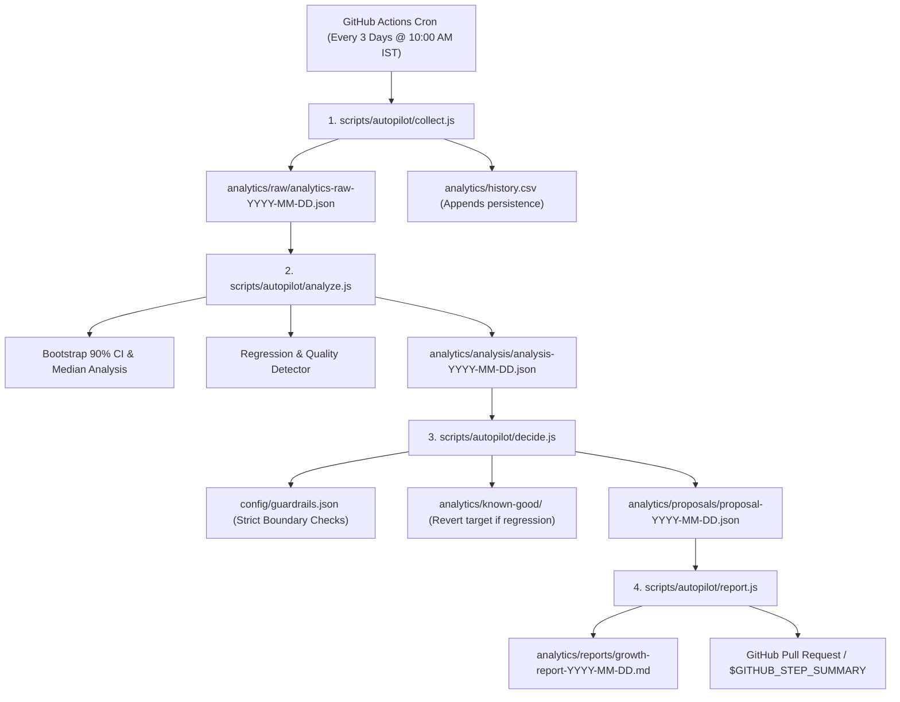

# 🚀 Growth Autopilot: System Architecture & Operator Manual

**Channel:** ExamIQ Bharat (`@examiqbharat`)  
**Channel ID:** `UCjh63suNzws9XB2sF1xKzyw`  
**Automation Frequency:** Every 3 days at 04:30 UTC (10:00 AM IST)  
**Workflow File:** [`.github/workflows/growth-autopilot.yml`](file:///c:/Users/hp/youtube-automation-agent/.github/workflows/growth-autopilot.yml)  

---

## 1. System Overview

The **Growth Autopilot** is a closed-loop analytical engine that:
1. Connects to the **YouTube Data API v3** and **YouTube Analytics API v2**.
2. Extracts live performance metrics (views, watch time, Average View Duration [AVD], Average Percentage Viewed [APV], subscriber conversions, traffic sources, and demographics).
3. Analyzes performance using **non-parametric medians and 90% Bootstrap Confidence Intervals**.
4. Pass proposals through **strict, immutable guardrails** to prevent algorithmic damage or policy violations.
5. Employs an **explore/exploit strategy** (70% exploit proven baseline, 30% explore controlled challenger variants).
6. Automatically detects regressions (>40% velocity drop) and triggers an instant restoration of the last known-good baseline.
7. Submits tuning proposals as **GitHub Pull Requests** rather than pushing unchecked configuration mutations directly to `master`.

---

## 2. Autopilot Architecture & Data Flow



### Module Responsibilities

| File | Purpose | Outputs |
| :--- | :--- | :--- |
| [`scripts/autopilot/collect.js`](file:///c:/Users/hp/youtube-automation-agent/scripts/autopilot/collect.js) | Pulls Data API + Analytics API v2; accounts for 72h data lag; preserves history. | `analytics/raw/*.json`, `analytics/history.csv` |
| [`scripts/autopilot/stats-helper.js`](file:///c:/Users/hp/youtube-automation-agent/scripts/autopilot/stats-helper.js) | Computes medians, percentiles, and 1,000-resample bootstrap confidence intervals. | Non-parametric statistical bounds |
| [`scripts/autopilot/analyze.js`](file:///c:/Users/hp/youtube-automation-agent/scripts/autopilot/analyze.js) | Joins video characteristics with metrics; runs regression checks; checks demographics & quality. | `analytics/analysis/*.json` |
| [`scripts/autopilot/decide.js`](file:///c:/Users/hp/youtube-automation-agent/scripts/autopilot/decide.js) | Compares variants against guardrails; proposes or applies safe changes to `config/growth.json`. | `analytics/proposals/*.json` |
| [`scripts/autopilot/report.js`](file:///c:/Users/hp/youtube-automation-agent/scripts/autopilot/report.js) | Compiles executive markdown reports, PR descriptions, and Step Summaries. | `analytics/reports/*.md` |
| [`scripts/autopilot/run.js`](file:///c:/Users/hp/youtube-automation-agent/scripts/autopilot/run.js) | CLI orchestrator running the 4-stage pipeline sequentially. | Complete pipeline execution |

---

## 3. Strict Safety Guardrails ([`config/guardrails.json`](file:///c:/Users/hp/youtube-automation-agent/config/guardrails.json))

The autopilot is hard-coded to reject any proposal violating these rules:

1. **Max Changes Per Run:** At most **2 configuration changes** per 3-day cycle.
2. **Format Variable Isolation:** At most **1 variable per format** (Shorts vs Long Form) per cycle to maintain clean single-variable A/B testing.
3. **Statistical Winner Threshold:**
   - Minimum sample size **$n \ge 5$** videos per variant.
   - 90% Bootstrap Confidence Intervals must be **completely disjoint (non-overlapping)**.
   - If $n < 5$ or intervals overlap, the system strictly logs: `Inconclusive, keep testing`.
4. **Allowed Parameter Ranges:**
   - `shorts.targetQuestionCount`: `[5, 10]`
   - `shorts.targetDurationSeconds`: `[35, 60]`
   - `shorts.pacingSecondsPerQuestion`: `[4.0, 7.0]`
   - `shorts.titleStyle`: Strictly limited to approved enum `["curiosity_lucent", "exam_targeted", "hybrid"]`
   - `longVideos.targetQuestionCount`: `[15, 30]`
   - `longVideos.dedupSimilarityThreshold`: `[0.35, 0.60]`
   - `longVideos.targetDurationMinutes`: `[6, 15]`
   - `cadence.maxShortsPerDay`: `[1, 2]`
   - `cadence.maxLongVideosPerDay`: `[1, 1]`
5. **Strictly Immutable Keys (Never Auto-Modified):**
   - Category ID (Hardcoded to **Education: 27**)
   - Video privacy status (`public` / `private`)
   - OAuth scopes
   - Video deletions or unlisting (Zero automated deletion policy)

---

## 4. Explore / Exploit Architecture

To balance reliable algorithmic reach with ongoing discovery:
- **70% Exploit (Winner):** 7 out of every 10 generated videos strictly use the proven configuration:
  - **Shorts:** `curiosity_lucent` title pattern, 10 questions, ~52s duration.
  - **Long Videos:** 20 high-yield questions, strict semantic deduplication (0.45 threshold), ~8 minutes duration.
- **30% Explore (Challenger):** 3 out of every 10 videos test controlled challenger variants (e.g. testing rapid 42s pacing vs 54s pacing, or hybrid title packaging).
- **Variant Tracking:** Every published video logs its active variant to [`analytics/experiments.csv`](file:///c:/Users/hp/youtube-automation-agent/analytics/experiments.csv).

---

## 5. Automated Regression Detection & Rollback

- **Regression Trigger:** If average view velocity over the last 3 days drops by **$\ge 40\%$** compared to the prior 14-day baseline, the detector triggers an automated alert.
- **Git Commit Join:** The system cross-references the drop window against recent git commits to highlight what code change coincided with the drop.
- **Automated Rollback Proposal:** Proposes immediate reversion to the last verified snapshot in [`analytics/known-good/`](file:///c:/Users/hp/youtube-automation-agent/analytics/known-good/).

### Manual Zero-Code Rollback
To immediately revert settings without writing any code:
1. Open [`config/growth.json`](file:///c:/Users/hp/youtube-automation-agent/config/growth.json).
2. Copy contents from [`analytics/known-good/growth-known-good-2026-10-16.json`](file:///c:/Users/hp/youtube-automation-agent/analytics/known-good/growth-known-good-2026-10-16.json).
3. Commit and push.

---

## 6. How to Run Locally

### Run Unit Test Suite
```powershell
npm run test:autopilot
```
*Verifies deduplication, bootstrap confidence intervals, guardrail enforcement, and dry-run pipeline with zero external API calls.*

### Run Autopilot in Dry-Run Mode
```powershell
npm run autopilot:run -- --dry-run
```
*Pulls live analytics, computes statistics, checks guardrails, generates reports, and writes proposals without modifying config.*

### Run Autopilot and Apply Safe Proposals
```powershell
npm run autopilot:run -- --apply
```
*Applies approved proposals directly to `config/growth.json`.*

---

## 7. Required GitHub Secrets & Actions Setup

The automated workflow relies on 3 repository secrets stored under **Settings > Secrets and variables > Actions**:

| Secret Name | Description | Status / Action Needed |
| :--- | :--- | :--- |
| `ENV_FILE` | Complete contents of `.env` | Already configured in repo |
| `GOOGLE_CREDENTIALS_JSON` | Content of `config/credentials.json` | Already configured in repo |
| `YOUTUBE_TOKENS_JSON` | Content of `config/tokens.json` | Already configured in repo |

### Refresh Token Expiry Handling
If Google revokes or expires the OAuth refresh token:
1. The workflow authentication step detects the failure immediately.
2. It fails cleanly with a distinct error message.
3. It automatically opens a GitHub Issue: `🚨 Action Required: YouTube OAuth Token Expired or Invalid`.
4. **Resolution:** Run `npm run credentials:setup` on your local terminal, then update `YOUTUBE_TOKENS_JSON` in GitHub Secrets.
